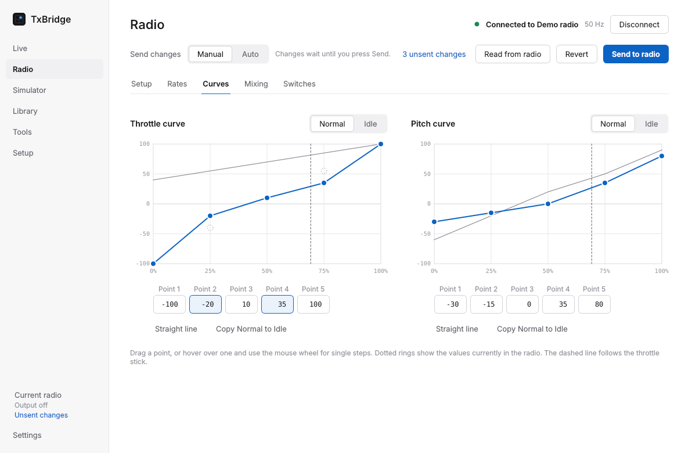

# TxBridge

<picture>
  <source media="(prefers-color-scheme: dark)" srcset="docs/screenshots/live-dark.png">
  
</picture>

TxBridge is an RC transmitter companion for desktop flight simulators. It currently connects FlySky FS-CT6A/B class transmitters over a USB trainer cable, monitors live channels, edits radio settings, and maps the sticks to a virtual game controller.

It targets the FS-CT6A/B family and rebadges such as HK-T6A, Turborix, Exceed and Storm ST-06TX. A read-only hardware test has confirmed one FS-CT6B; other models still need field reports.

Other planned target families include FlySky FS-i6/i6X, FrSky Taranis/OpenTX, RadioMaster EdgeTX and Spektrum. Those radios are **not supported yet**: each model needs its own protocol or input integration and hardware validation before it can be listed as supported.

## Status

The app and protocol test suite include a software radio. A read-only smoke test has also succeeded on Windows with a real FS-CT6B: TxBridge received live channel frames and read the radio's settings over its USB-serial cable. Radio-setting writes and calibration have not been tested on hardware. `docs/PROTOCOL.md` says which parts of the protocol are verified and which are inferred; hardware reports from other radios and cables are welcome.

## Install

Download the latest installers from the [GitHub Releases page](https://github.com/ahenali/TxBridge/releases/latest).

### Windows

Download `TxBridge-Setup-x.y.z.exe` and run it. The installer adds TxBridge to the Start menu; it can also create a desktop shortcut. A portable zip is available too: unpack it anywhere and TxBridge keeps settings in a `data` folder next to the program.

Windows may show a SmartScreen warning because the installer is not code-signed yet. The release includes `SHA256SUMS.txt` if you want to check your download.

### Linux

Releases include an x86-64 **AppImage** and a **Debian/Ubuntu `.deb`** package:

- For the AppImage, download it, make it executable (`chmod +x TxBridge-*.AppImage`), then run it. AppImages require FUSE support; if your desktop does not provide it, use the `.deb`.
- On Debian/Ubuntu 64-bit (Ubuntu 22.04+ or Debian 12+), open the `.deb` with the software installer, or run `sudo apt install ./txbridge_<version>_amd64.deb`. The package adds a TxBridge application-menu entry and installs its required system libraries.

For serial radio cables on Linux, your user needs serial-device access. If needed, run `sudo usermod -aG dialout "$USER"` and sign out and back in. The optional uinput simulator backend also needs write access to `/dev/uinput`.

### Drivers

Open the **Setup** page. It shows what is present and what is missing:

- **Radio cable.** The cable appears as a serial port. Windows usually installs its driver on its own. If no port shows up, Setup links to the driver pages for the common chips (Prolific PL2303, WCH CH340, Silicon Labs CP210x, FTDI).
- **vJoy.** Needed to present the sticks to a simulator. Press Install and TxBridge downloads the installer from the [vJoy releases](https://github.com/njz3/vJoy/releases) and starts it. Windows asks for administrator permission and the installer's own window opens; nothing is installed silently.
- **ViGEmBus.** Optional. Only needed if a simulator insists on an Xbox 360 controller. The [project](https://github.com/nefarius/ViGEmBus) is retired, but its final release still works.

Downloads come from GitHub over HTTPS. For the versions TxBridge was written against, the file's SHA-256 has to match a pinned value. A newer release is accepted only if Windows reports a valid digital signature on it. Otherwise TxBridge refuses to run it and points you at the release page.

## Using it

1. Connect the radio and press **Connect**. No radio yet? **Demo radio** is a software radio you can drag around, so you can set everything up before the cable arrives.
2. **Live** shows the six channels. The marks on each bar are the lowest and highest values seen since the last reset.
3. **Simulator**: pick vJoy, press Start sending, and map the channels to axes. Use Sweep to move one axis end to end while the simulator's control screen is waiting for input. Learn range measures how far your sticks really travel, in software, without touching the radio.
4. A profile can name the programs it belongs to (for example `Liftoff.exe`) and TxBridge switches to it when one starts.

<picture>
  <source media="(prefers-color-scheme: dark)" srcset="docs/screenshots/simulator-dark.png">
  
</picture>

### Editing the radio

The **Radio** page edits everything stored in the transmitter: model type, stick mode, reverse, end points, subtrim, dual rates, throttle and pitch curves, the three mixes, switches and variables. A field you have changed gets a blue outline until it is sent. Press **Send to radio** (or switch to Auto), and TxBridge reads the settings back to confirm the radio took them. A copy of what was in the radio is saved to the library before every send.

<picture>
  <source media="(prefers-color-scheme: dark)" srcset="docs/screenshots/radio-curves-dark.png">
  
</picture>

The **Library** keeps models you have saved, with search, tags, compare and load-and-send. Models export to `.cfg` (the format t6config uses), CSV, XLSX and PDF, and the whole library can be backed up and restored.

## Build from source

You need Python 3.10 or newer.

```
pip install -r requirements.txt
python run_txbridge.py --demo
```

The Xbox 360 output needs `pip install -r requirements-xbox.txt` on Windows. On Linux, TxBridge can use uinput (`pip install evdev`).

To build the Windows program, installer and portable zip:

```
build_windows.bat
```

That script needs [Inno Setup 6](https://jrsoftware.org/isdl.php) for the installer; without it you still get the program folder and the zip. On Linux, build the AppImage and Debian package with `bash packaging/build_linux.sh <version>` after building `dist/TxBridge` with PyInstaller. Pushing a version tag makes GitHub Actions build the Windows and Linux packages and attach them to a release. Run the tests with `pytest`.

## How it was made

The FS-CT6A/B protocol is independently implemented from reverse-engineered packet behavior and checked against a real CT-6B. TxBridge does not include another application's code, artwork or licensing logic. Protocol details that are inferred rather than hardware-verified are identified in [docs/PROTOCOL.md](docs/PROTOCOL.md).

## License

MIT, see [LICENSE](LICENSE).
